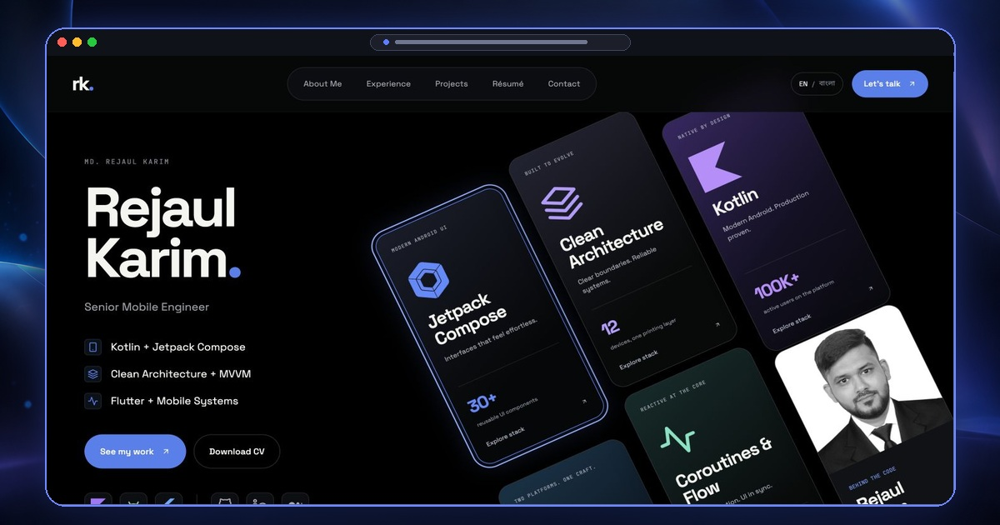
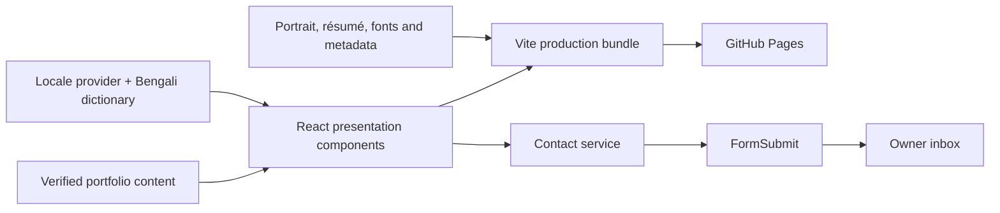

# Rejaul Karim — Portfolio

[](https://rktuhinbd.github.io/portfolio/)
[](https://github.com/rktuhinbd/portfolio/actions/workflows/deploy.yml)
[](https://react.dev/)
[](https://www.typescriptlang.org/)

A bilingual, production-ready portfolio for **Md. Rejaul Karim**, a Senior Mobile Engineer specializing in Android, Kotlin, Jetpack Compose, Flutter and scalable mobile architecture. The site turns verified career history into a focused product story with interactive technology cards, measurable outcomes, accessible motion and a working contact channel.

**Live site:** [rktuhinbd.github.io/portfolio](https://rktuhinbd.github.io/portfolio/)

[](https://rktuhinbd.github.io/portfolio/)

## Product goals

- Present engineering impact, ownership and measurable outcomes clearly.
- Keep career history, dates, technology claims and project links aligned with the résumé.
- Provide an equally complete English and Bengali experience without layout shifts.
- Deliver a fast, accessible static site that is simple to maintain and publish.
- Provide a verified contact path without exposing credentials in the browser.

## Features

- Complete English and Bengali localization with persisted language preference.
- Stable navigation and component geometry across both languages.
- Floating technology cards with animated, keyboard-accessible detail dialogs.
- Pointer-responsive dotted field, glass hover treatment and magnetic contact links.
- Visible 10 Minute School tenure and promotion history from August 2021 to June 2025.
- Responsive project gallery with verified product links and mobile horizontal scrolling.
- Downloadable résumé, local fonts, social preview, canonical metadata, sitemap and structured data.
- Contact form with validation, spam honeypot, timeout handling and confirmed inbox delivery.
- Reduced-motion support, skip navigation, visible focus styles and semantic landmarks.
- Automated type checking, linting, interaction tests, production builds and GitHub Pages deployment.

## Architecture

This project uses a **content-driven, layered component architecture** built around React’s one-way data flow. It is not MVVM or formal Clean Architecture. Those patterns are valuable for larger applications with complex domain rules, data sources and long-lived presentation state; this portfolio is a static single-page interface, so a smaller architecture is clearer and easier to maintain.



| Layer                 | Files                                    | Responsibility                                                                 |
| --------------------- | ---------------------------------------- | ------------------------------------------------------------------------------ |
| Presentation          | `src/App.tsx`, `src/index.css`           | Sections, responsive layout, motion and accessible interaction states          |
| Content               | `src/content.ts`                         | Résumé-backed career history, projects, technology evidence and external links |
| Localization          | `src/i18n.tsx`, `src/translations.bn.ts` | Locale state, persistence, document metadata and Bengali copy                  |
| Service               | `src/contact.ts`                         | Contact validation, endpoint policy, timeout and provider response handling    |
| Static infrastructure | `public/`, `index.html`                  | Images, résumé, local metadata, SEO and install-free public assets             |
| Verification          | `src/test/`, GitHub Actions              | UI contracts, localization consistency, contact behavior and release checks    |

This structure fits the current scope because content, UI state and external delivery concerns remain separate without adding routing, global state libraries or server infrastructure that the product does not need. See [Architecture](docs/ARCHITECTURE.md) for the full rationale and data flow.

## Technology stack

| Area       | Technology                                       | Use                                                                 |
| ---------- | ------------------------------------------------ | ------------------------------------------------------------------- |
| Interface  | React 19                                         | Component composition, state and accessible interactions            |
| Language   | TypeScript 5                                     | Typed content models and safer changes                              |
| Build      | Vite 7                                           | Local development and optimized `/portfolio/` bundle                |
| Motion     | Framer Motion 12, CSS, Web Animations API        | Reveals, floating cards, dialog transitions and pointer effects     |
| Styling    | Tailwind CSS 4 tooling, authored CSS             | Responsive layout, design tokens, typography and interaction states |
| Icons      | React Icons                                      | Technology, navigation and social symbols                           |
| Typography | Space Grotesk, JetBrains Mono, Noto Sans Bengali | Locally bundled Latin, technical and Bengali text                   |
| Contact    | FormSubmit AJAX endpoint                         | Serverless email delivery with explicit UI states                   |
| Testing    | Vitest, Testing Library, jsdom                   | Interaction, localization and contact contracts                     |
| Quality    | TypeScript, ESLint, Prettier                     | Static checks and consistent formatting                             |
| Delivery   | GitHub Actions, GitHub Pages                     | Repeatable validation and HTTPS publishing                          |

## Getting started

### Prerequisites

- [Git](https://git-scm.com/)
- Node.js 24; the repository includes `.nvmrc`
- pnpm 11.25.0; the exact version is pinned in `package.json`

### Download and install

Download the repository ZIP from GitHub and extract it, or clone it:

```sh
git clone https://github.com/rktuhinbd/portfolio.git
cd portfolio
corepack enable
pnpm install --frozen-lockfile
```

Start the development server:

```sh
pnpm dev --host 127.0.0.1 --port 4173
```

Open `http://127.0.0.1:4173/portfolio/` in a browser.

### Validate a production build

```sh
pnpm check
pnpm build
pnpm preview --host 127.0.0.1 --port 4173
```

The production preview is available at `http://127.0.0.1:4173/portfolio/`. Vite writes the deployable output to `dist/`; that generated folder is intentionally excluded from Git.

## Commands

| Command             | Purpose                                     |
| ------------------- | ------------------------------------------- |
| `pnpm dev`          | Start the Vite development server           |
| `pnpm typecheck`    | Check TypeScript without emitting files     |
| `pnpm lint`         | Run TypeScript and ESLint checks            |
| `pnpm test`         | Run the interaction and service test suite  |
| `pnpm format:check` | Verify repository formatting                |
| `pnpm check`        | Run lint, tests and formatting checks       |
| `pnpm build`        | Type-check and create the production bundle |
| `pnpm preview`      | Serve the built bundle locally              |

## Project structure

```text
portfolio/
├── .github/workflows/
│   ├── deploy.yml              # Approved production deployment
│   └── preview.yml             # Branch and pull-request validation
├── docs/
│   ├── ARCHITECTURE.md         # Architectural decisions and data flow
│   ├── DEPLOYMENT.md           # Publishing and rollback guide
│   ├── FILE-TREE.md            # Maintained source inventory
│   └── VERIFICATION.md         # Release and delivery evidence
├── public/
│   ├── assets/                 # Supplied and optimized portrait
│   ├── resume.pdf              # Downloadable résumé
│   ├── favicon.png
│   ├── apple-touch-icon.png
│   ├── social-preview.jpg
│   ├── robots.txt
│   └── sitemap.xml
├── src/
│   ├── test/                   # UI, contact and localization tests
│   ├── App.tsx                 # Page sections and interaction components
│   ├── contact.ts              # Contact service and validation
│   ├── content.ts              # Career, project and technology data
│   ├── i18n.tsx                # Locale provider and persistence
│   ├── translations.bn.ts      # Bengali localization dictionary
│   ├── index.css               # Design system and responsive rules
│   └── main.tsx                # Application entry point
├── .env.example                # Optional public contact endpoint override
├── .nvmrc                      # Node.js version
├── .prettierignore             # Generated and lockfile formatting exclusions
├── index.html                  # HTML shell and search metadata
├── package.json                # Scripts and dependencies
├── pnpm-lock.yaml              # Reproducible dependency graph
├── tsconfig.json
├── vite.config.js
└── vitest.config.ts
```

The complete annotated inventory is in [File tree](docs/FILE-TREE.md).

## Content and localization

- Update career history, projects, technology evidence and URLs in `src/content.ts`.
- Update Bengali interface copy in `src/translations.bn.ts`.
- Replace `public/resume.pdf` and verify that the website dates and metrics still match it.
- Replace both portrait formats together when updating the photograph.
- Preserve product names, email addresses and destination URLs when localizing labels.
- Check English and Bengali at desktop and mobile breakpoints after changing visible copy.

## Contact delivery

The default contact path posts directly from the browser to FormSubmit for `rejaul.karim.pro@gmail.com`. Recipient activation and live Gmail delivery from the published domain were verified on 15 October 2026. The UI distinguishes sending, activation-pending, success, validation, timeout and provider-error states while retaining the message on failure.

`VITE_FORMSPREE_ENDPOINT` may optionally replace the public endpoint. It is an endpoint URL, not a secret. Never commit mail credentials, private tokens or an unrestricted API key to a Vite application. See [Verification](docs/VERIFICATION.md) for the current evidence.

## Deployment and maintenance

GitHub Pages serves the static production bundle from the project path `/portfolio/`. The production workflow is manual and only deploys `main`; branch and pull-request workflows validate the same locked dependency graph and upload a preview artifact.

Before publishing a content or dependency update:

1. Run `pnpm check` and `pnpm build`.
2. Inspect English and Bengali on desktop and mobile.
3. Verify navigation, technology dialogs, résumé links and the contact form.
4. Push the reviewed commit to `main`.
5. Run **Approved production deployment** in GitHub Actions and verify the live URL.

Detailed publishing and rollback instructions are in [Deployment](docs/DEPLOYMENT.md).

## Assets and ownership

The portrait, résumé content, personal identity and career information belong to Md. Rejaul Karim. Interface graphics and metric panels are project-specific assets. Libraries and fonts retain their respective licenses. No permission to reuse personal photographs, résumé content or identity is granted by the presence of this public repository.
