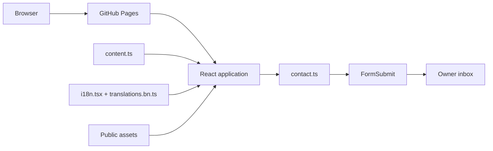

# Architecture

## Decision

The portfolio uses a **content-driven, layered React component architecture** with one-way data flow. It deliberately avoids MVVM and formal Clean Architecture because it has one page, a small amount of local UI state, no database and no complex domain layer.

The design follows the React model: data is stored separately, presentation is composed from components, state lives near the interactions that own it, and shared locale state is provided through context. This keeps the code direct while preserving clear boundaries.

## System view

## Layers and boundaries

| Layer                 | Modules                          | Responsibility                                                        |
| --------------------- | -------------------------------- | --------------------------------------------------------------------- |
| Bootstrap             | `main.tsx`                       | Mount React and load fonts/styles                                     |
| Presentation          | `App.tsx`, `index.css`           | Sections, semantic markup, responsive layout and motion               |
| Content               | `content.ts`                     | Verified career, project and technology data                          |
| Localization          | `i18n.tsx`, `translations.bn.ts` | Language state, persistence, metadata and translations                |
| Service               | `contact.ts`                     | Validation, allowlisted endpoint, timeout and response classification |
| Static infrastructure | `public/`, `index.html`          | Résumé, portrait, icons and search/social metadata                    |
| Verification          | `src/test/`, workflows           | Behavior contracts and production gates                               |

## State and interaction model

React state is local to the feature that owns it: active navigation section, mobile menu, selected technology, contact status, copied-email feedback and language. Locale is the only cross-page concern, so it uses a small context provider and local storage. There is no global store because the interface has no shared server cache or complex state graph.

Section anchors provide navigation without a router. Native dialogs lock background scrolling, contain keyboard focus, support Escape/outside-click dismissal and restore focus to the selected technology card. Motion uses Framer Motion, CSS and the Web Animations API; reduced-motion preferences disable optional movement.

## Localization strategy

English source strings map to one Bengali dictionary. The locale provider updates the document language, title and stored preference. Brand text, addresses and destination URLs remain invariant. Fixed component geometry and shared type scales prevent the header and major controls from moving when the locale changes.

## Contact data flow

The form validates name, reply email and message before posting. A honeypot discourages basic spam, duplicate submissions are blocked, and requests have a timeout. Provider acceptance, activation-pending and delivery failures have distinct UI states. Contact credentials never enter the frontend.

FormSubmit recipient activation and a complete live delivery to Gmail were verified on 15 October 2026. Repeat the live check after changing the recipient, endpoint or production domain.

## Why this architecture fits

- It separates volatile résumé content from rendering and delivery logic.
- It follows React’s component hierarchy and one-way data flow.
- It keeps the static bundle compatible with GitHub Pages.
- It is straightforward to test because the contact service and localization functions are isolated.
- It avoids infrastructure and abstraction that would add maintenance cost without improving this product.

If the portfolio later adds authenticated editing, a CMS, multiple routed case-study pages or substantial server data, feature folders and a server-facing data layer would become appropriate. For the current scope, the existing layers are sufficient.

## Delivery

Vite compiles the site to `dist/` with the required `/portfolio/` base. GitHub Actions installs the locked dependencies, checks types and lint, runs tests, builds the bundle and deploys it to GitHub Pages. Production deployment is manual and limited to `main`.
