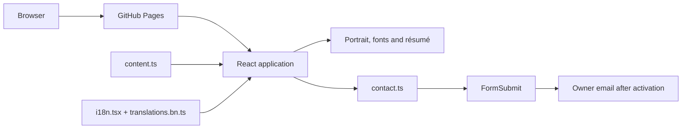

# Architecture

## System overview

A static React application served by GitHub Pages at `/portfolio/`. Vite compiles TypeScript and CSS into `dist/`. There is no application server or database; contact delivery is delegated to FormSubmit.

## Responsibilities

| Module                   | Responsibility                                                      |
| ------------------------ | ------------------------------------------------------------------- |
| `src/main.tsx`           | Application bootstrap and font/style imports                        |
| `src/App.tsx`            | Sections, navigation, technology dialogs, motion and contact form   |
| `src/content.ts`         | Career history, project links and technology evidence               |
| `src/i18n.tsx`           | Language context, persistence and document language                 |
| `src/translations.bn.ts` | Bengali copy and technical transliterations                         |
| `src/contact.ts`         | Endpoint allowlist, validation, timeout and response classification |
| `src/index.css`          | Responsive layout, visual tokens, focus and motion treatments       |
| `public/`                | Static downloadable assets and search metadata                      |

## Interaction model

Section anchors provide navigation without a router. Native dialogs lock background scrolling, contain focus, support Escape and restore focus to the invoking card. Animation uses Framer Motion, CSS and the Web Animations API. System reduced-motion preferences disable optional motion. Pointer-reactive effects are adapted for touch screens.

Language selection is stored locally. English source copy maps to Bengali translations; technical names are transliterated consistently. Actual URLs and email addresses remain unchanged.

## Contact data flow

Name, reply email and message are validated before submission. A hidden honeypot discourages basic spam. Requests have a timeout; pending activation and errors preserve entered text. Provider acceptance is not proof of inbox receipt. Recipient activation and live delivery to Gmail were verified on 15 October 2026; repeat this check after changing the domain, endpoint or recipient.

No API secret belongs in the frontend. `VITE_FORMSPREE_ENDPOINT` is an optional public endpoint override, not a credential. No custom dashboard is necessary for the current email-only requirement.

## Delivery and maintenance

The preview workflow installs the locked dependencies, checks types/lint, runs tests and builds an artifact. The production workflow deploys the main branch through GitHub Pages when manually triggered. Production assets use `/portfolio/`; changing the repository name requires updating the Vite base, canonical URL, sitemap, robots and contact source URL together.

Keep résumé claims in `content.ts` aligned with `public/resume.pdf`. Add translations and tests when adding copy or interactions. Validate desktop/mobile layouts after content changes. The implementation intentionally uses independent visuals instead of the reference author's assets.
